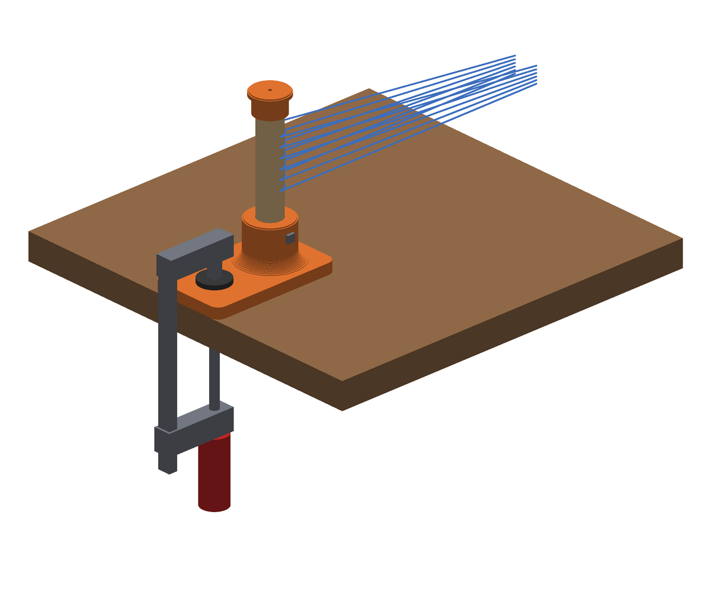
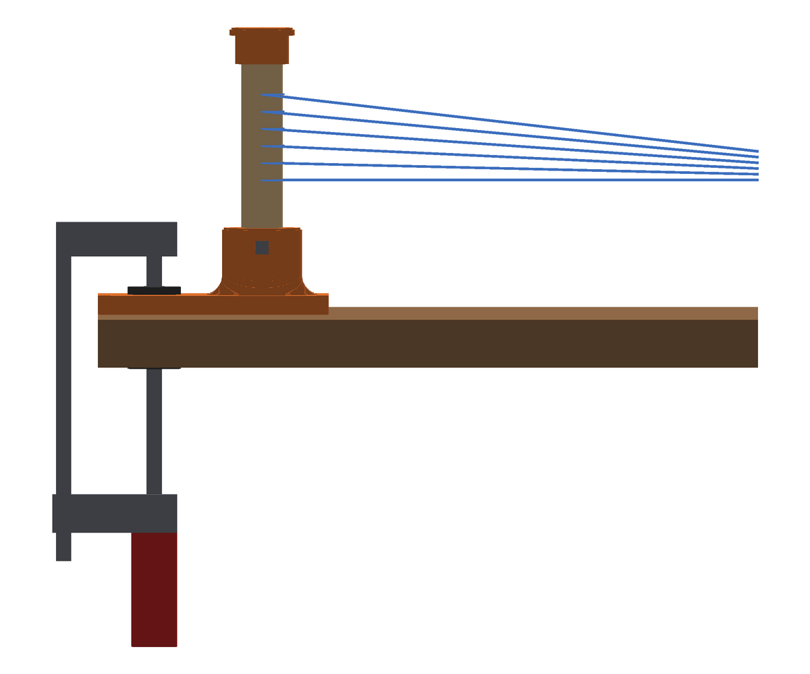

# Loom warping peg: warping peg with table clamp

A separate warping peg for direct warping on the
[rigid heddle loom](https://github.com/pa3hcm/rigid-heddle-loom). The peg stands upright at the other end of the table
and is held to the table edge with an F-clamp. The Dutch version is in
[README_dutch.md](README_dutch.md).





## How it works

- A **printed base**: a flat plate of 70 × 121 × 10 mm with a socket (Ø 42 mm) that holds the
  dowel 42 mm deep. A concave fillet between socket and plate makes the joint strong.
- The plate lies flat on the table, **flush with the table edge**. The first 55 mm from the edge
  is flat and free: that is where the jaw of the F-clamp goes. The rail of the clamp is outside
  the table edge.
- The peg is 86 mm from the edge, beyond the clamp as seen from the loom. The warp pulls the peg
  towards the loom; the plate then wants to lift at the edge side, which is exactly where the
  clamp is.
- **Dowel**: beech Ø 22 mm, the same as the rollers of the loom, cut to 143 mm. The top of the
  peg is then 150 mm above the table.
- A **locking screw** 3.5 × 25 mm through the side of the socket holds the dowel (as on the
  ratchet wheels of the loom). Pre-drill 2 mm.
- A **cap** (Ø 34 mm) on top keeps the loops on the peg. Press it on; a drop of wood glue makes
  it permanent.

## Files

| File | What |
|---|---|
| `peg_base.stl` | base with socket, print 1 |
| `peg_cap.stl` | cap (upside down, as printed), print 1 |
| `generate_stl.py` | creates the STLs; all dimensions are at the top and can be changed |
| `render.py` | creates the impressions (`python3 render.py` and `python3 render.py side`) |
| `PROMPT.md` | reusable prompt with all design choices, to continue later with an AI assistant |

Rebuild everything after a change:

```bash
python3 generate_stl.py && python3 render.py && python3 render.py side
```

## Shopping list

| What | Qty |
|---|---|
| Beech dowel Ø 22 mm, 143 mm (not enough is left of the 2 m bought for the loom) | 1 |
| Wood screw 3.5 × 25 mm (locking screw) | 1 |
| F-clamp, at least 60 mm throat depth, opening of table thickness + 10 mm | 1 |
| Optional: non-slip mat, cork or felt under the plate | 70 × 121 mm |

## Printing

- PETG (or PLA), 4 walls, 30–40 % infill, 0.2 mm layers.
- The base lies with the plate on the bed, the cap with its top on the bed. No supports.
- Measure your dowel and set `DOWEL_D` at the top of `generate_stl.py` (now 21.7 mm, with
  0.4 mm clearance). For a different height change `PEG_HEIGHT`: the script prints the length
  to cut the dowel to.

## Build and use

1. Cut the dowel to 143 mm and round the top edge a little.
2. Push the dowel into the socket down to the bottom, pre-drill 2 mm through the hole in the
   socket and drive in the locking screw.
3. Press the cap onto the dowel.
4. Put the base with the peg towards the loom, the straight edge flush with the table edge, and
   put the F-clamp on the flat part. A piece of cardboard or felt under the lower jaw protects
   the table.
5. Place the peg at the warp length (for example 1.5–2 m) from the loom and warp as described
   in the loom's instructions.

## Design choices

- Printed rather than laser cut: one piece, no glue joints, and the socket keeps the dowel square.
- The same dowel size and locking screw as the loom, so no new sizes or tools.
- No lip over the table edge: table edges are often rounded or have an apron, and the clamp holds
  the plate firmly enough. A non-slip mat under the plate helps with high tension.
- The small hole at the bottom of the socket and in the cap lets air out; through the bottom
  hole you can also push the dowel out again.

## License

[CC BY-NC 4.0](LICENSE), like the loom.
