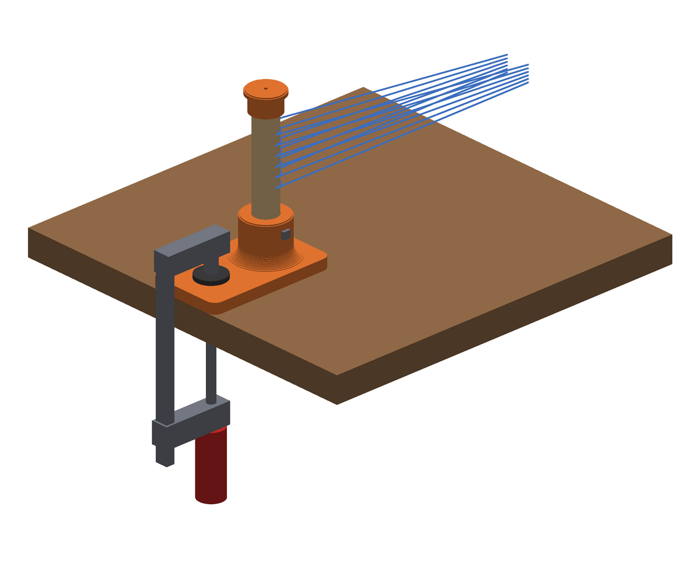
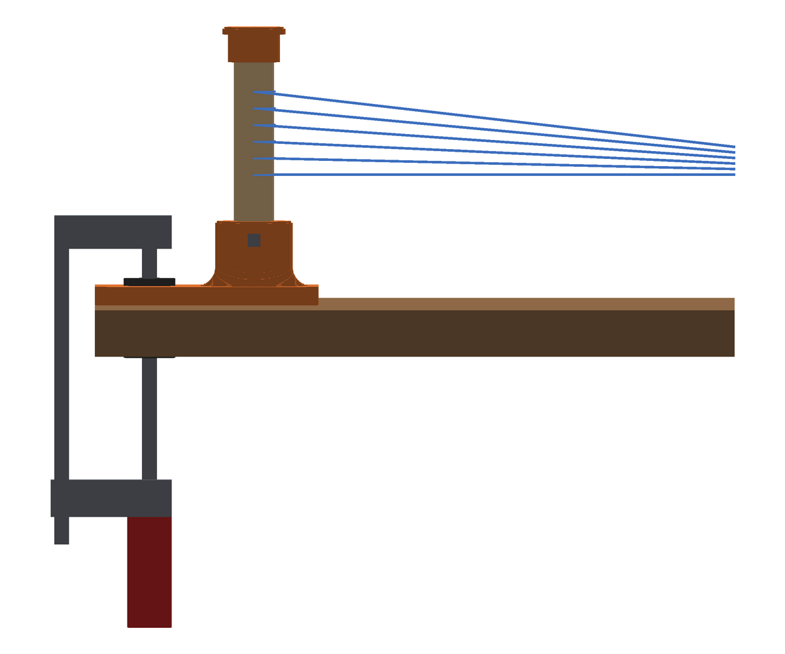

# Loom warping peg: scheerpen met tafelklem

Een losse scheerpen voor het direct scheren (inspannen) op het
[rigid heddle weefgetouw](https://github.com/pa3hcm/rigid-heddle-loom). De pen staat rechtop aan de andere kant van de
tafel en wordt met een F-klem aan de tafelrand vastgezet. De Engelse versie staat in
[README.md](README.md).

In het Engels heet dit een **warping peg** (ook wel *warping post*); de klem die erbij hoort heet
een *table clamp* of *warping peg clamp*.





## Hoe het werkt

- Een **geprint voetstuk**: een vlakke plaat van 70 × 121 × 10 mm met daarop een koker
  (Ø 42 mm) waarin de stok 42 mm diep steekt. Een holle afronding tussen koker en plaat maakt de
  overgang stevig.
- De plaat ligt plat op tafel, **gelijk met de tafelrand**. De eerste 55 mm vanaf de rand is
  vlak en vrij: daar komt de bek van de F-klem. De rail van de klem staat buiten de tafelrand.
- De pen staat 86 mm van de rand en dus ná de klem, gezien vanaf het getouw. De draden trekken
  de pen naar het getouw toe; de plaat wil dan aan de randkant omhoog komen, en precies daar
  zit de klem.
- **Stok**: beuken rondhout Ø 22 mm, hetzelfde als de rollen van het getouw, op 143 mm gezaagd.
  De top van de pen staat dan 150 mm boven het tafelblad.
- Een **borgschroef** 3,5 × 25 mm zijdelings door de koker zet de stok vast (net als bij de
  palraderen van het getouw). Voorboren met 2 mm.
- Een **dopje** (Ø 34 mm) op de bovenkant houdt de lussen op de pen. Druk het erop; een druppel
  houtlijm maakt het blijvend.

## Bestanden

| Bestand | Wat |
|---|---|
| `peg_base.stl` | voetstuk met koker, 1 printen |
| `peg_cap.stl` | dopje (ondersteboven, zoals het geprint wordt), 1 printen |
| `generate_stl.py` | maakt de STL's; alle maten staan bovenaan en zijn aan te passen |
| `render.py` | maakt de impressies (`python3 render.py` en `python3 render.py side`) |
| `PROMPT.md` | herbruikbare prompt (Engels) met alle ontwerpkeuzes, om later met een AI-assistent verder te werken |

Alles opnieuw maken na een wijziging:

```bash
python3 generate_stl.py && python3 render.py && python3 render.py side
```

## Inkoop

| Wat | Aantal |
|---|---|
| Beuken rondhout Ø 22 mm, 143 mm (van de 2 m voor het getouw blijft te weinig over) | 1 |
| Houtschroef 3,5 × 25 mm (borgschroef) | 1 |
| F-klem met minstens 60 mm diepte en een bereik van tafeldikte + 10 mm | 1 |
| Optioneel: anti-slipmat, kurk of vilt onder de plaat | 70 × 121 mm |

## Printen

- PETG (of PLA), 4 wanden, 30–40 % infill, 0,2 mm laaghoogte.
- Het voetstuk ligt met de plaat op het bed, het dopje met de bovenkant op het bed. Geen
  support nodig.
- Meet je rondhout met een schuifmaat en vul de maat in bij `DOWEL_D` bovenaan
  `generate_stl.py` (nu 21,7 mm, met 0,4 mm speling). Wil je een andere hoogte, pas dan
  `PEG_HEIGHT` aan: het script geeft de zaaglengte van de stok.

## Bouwen en gebruiken

1. Zaag de stok op 143 mm en schuur de bovenrand iets rond.
2. Duw de stok in de koker tot op de bodem, boor 2 mm voor door het gat in de koker en draai
   de borgschroef erin.
3. Druk het dopje op de stok.
4. Leg het voetstuk met de pen naar het getouw toe, de rechte rand gelijk met de tafelrand, en
   zet de F-klem op het vlakke deel. Een stukje karton of vilt onder de onderste bek beschermt
   de tafel.
5. Zet de pen op de afstand van de gewenste kettinglengte (bijvoorbeeld 1,5–2 m) van het
   getouw, en schering zoals in de handleiding van het getouw.

## Ontwerpkeuzes

- Geprint in plaats van gelaserd: één stuk, geen lijmnaden, en de koker houdt de stok haaks.
- Dezelfde rondhoutmaat en borgschroef als het getouw, dus geen nieuwe maten of gereedschap.
- Geen lip over de tafelrand: tafelranden zijn vaak afgerond of hebben een rand, en de klem
  houdt de plaat ruim genoeg vast. Een anti-slipmat onder de plaat helpt bij veel spanning.
- Het kleine gaatje onderin de koker en in het dopje laat lucht ontsnappen; door het gaatje
  onderin kun je de stok er ook weer uitduwen.

## Licentie

[CC BY-NC 4.0](LICENSE), net als het weefgetouw.
